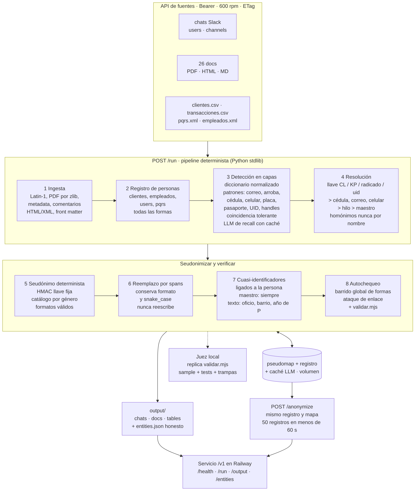

# kipu-anon

Servicio del **Reto 1 de Frontier** ("Vende los datos sin vender a la gente"): anonimiza el corpus de
Kipu Pay (chats de soporte, documentos internos y tablas de clientes, transacciones, PQRS y empleados)
**uno a uno**, para que siga sirviendo para entrenar modelos y nadie sea reidentificable. Cada persona
es una sola persona de punta a punta, también cuando las fuentes crecen.

- Python 3.12, **solo librería estándar** (cero dependencias). Modelos vía OpenRouter (solo recall).
- Texto: se **reemplaza**, nunca se reescribe. Sin datos reales en este repo.
- Diseño: [`docs/diseno.html`](docs/diseno.html) · Decisiones y costos: [`DECISIONS.md`](DECISIONS.md)

**Servicio:** `https://kipu-anon-production.up.railway.app/v1`

## Contrato del servicio

Raíz `/v1`, UTF-8. **Todas las rutas llevan `Authorization: Bearer <TEAM_TOKEN>`, excepto `GET /health`.**

| Método y ruta | Auth | Qué hace |
|---|---|---|
| `GET /v1/health` | no | `{status, team, version, models}` |
| `POST /v1/run` | sí | Recibe `{sources_url, token}` y regenera `output/` desde el API de fuentes; devuelve `{job_id}` (202). Solo `https` con IP pública |
| `GET /v1/run/{job_id}` | sí | Estado (`queued`, `running`, `done`, `failed`), conteo de registros y costo (tokens y segundos) |
| `GET /v1/output/{archivo}` | sí | `chats.jsonl`, `docs.jsonl`, `tables.jsonl` o `entities.json` de la última corrida terminada |
| `POST /v1/anonymize` | sí | Recibe `{source, records}` (hasta 50 registros) y devuelve los mismos ids anonimizados más las entidades que intervinieron. Misma persona → mismo seudónimo; persona nueva → seudónimo nuevo y único |
| `GET /v1/entities` | sí | Diccionario completo de la última corrida (solo para el jurado: lleva formas originales) |

Errores: 401 token inválido, 404 ruta o corrida inexistente, 413 cuerpo demasiado grande, 422 esquema
inválido, 500 genérico (sin PII en el mensaje ni en los logs). Contrato completo:
`material/frontier-reto-1/api/participante.openapi.yaml` (carpeta local, no versionada).

```bash
# desde cualquier carpeta
curl -s https://kipu-anon-production.up.railway.app/v1/health
curl -s -X POST https://kipu-anon-production.up.railway.app/v1/anonymize \
  -H "Authorization: Bearer $TEAM_TOKEN" -H "Content-Type: application/json" \
  -d '{"source":"chats","records":[{"id":"x1","thread_id":"soporte:1","author":"Cliente","ts":"1.0","text":"Hola, soy Marta Rojas","attachments":[]}]}'
```

## Correr en local

```bash
cd kipu-anon
cp .env.example .env            # llena OPENROUTER_API_KEY, TEAM_TOKEN, etc. (.env está en .gitignore)
./run.sh                        # servicio en :9000 (rutas con y sin /v1)

# o sin servicio, directo sobre una carpeta o el API de fuentes
python3 -m kipu run --local sample/input --out /tmp/k_sample
python3 -m kipu run --api --out /tmp/k_real          # usa SOURCES_URL y SOURCES_TOKEN
```

Variables (solo en entorno; ver `.env.example`): `SOURCES_URL`, `SOURCES_TOKEN`, `OPENROUTER_API_KEY`,
`KIPU_LLM_MODEL` (opcional), `TEAM_TOKEN`, `DATA_DIR` (estado, mapa de seudónimos y caché del LLM),
`PORT`. Sin `OPENROUTER_API_KEY` el pipeline sigue solo con reglas.

Despliegue: `Dockerfile` + `railway.json` (1 réplica, sin reposo, volumen en `DATA_DIR`, healthcheck
en `/v1/health`).

## Juez local

`evals/` replica al juez del reto (misma normalización que `validar.mjs`) y estima el puntaje 0-100
sin gastar una de las 3 corridas oficiales. Solo librería estándar, sin LLM.

```bash
cd kipu-anon
evals/run_all.sh          # genera trampas y canarios, corre pruebas, el pipeline sobre sample/ y fuentes/, y el juez
python3 evals/juez.py --out <salida> --ref sample/expected_output --input sample/input --tests sample/tests_sample.json
node material/frontier-reto-1/validar.mjs <salida> --public <carpeta con record_index.json>
```

Reporta por familia (directa, indirecta, oculta, falso positivo, homónimos, consistencia), barrido
global de formas reales, partición de personas contra la salida ideal, parecido y estructura. Las
partes que son aproximadas están marcadas; un 100 local no garantiza 100 en los tests ocultos.
`evals/trampas.jsonl` y `evals/inyecciones.jsonl` llevan datos del corpus, así que se regeneran desde
`fuentes/` y no se versionan.

## Arquitectura en 8 pasos



1. **Ingesta exhaustiva.** API con ETag y backoff (o carpeta local). Lee todos los rincones donde hay
   PII: metadatos de PDF (UTF-16), comentarios HTML/XML, front matter, `<meta>`, adjuntos, URLs.
   Salida 1:1 con `record_index`.
2. **Grafo de identificadores.** Los nodos son llaves fuertes (cliente, empleado, uid, radicado,
   cédula, correo, celular, placa, pasaporte, crédito); el nombre es una etiqueta, nunca una llave.
3. **Detección en capas.** Diccionario de formas con la normalización del juez, patrones (correos,
   deletreados, cédulas, celulares, placas, pasaportes, créditos, direcciones, honoríficos),
   coincidencia tolerante y un **LLM de recall** por hilo o documento, cacheado.
4. **Resolución con evidencia.** Llave en el registro > identificador fuerte > fecha + monto >
   adjunto > participantes del hilo; gazetteer del corpus contra falsos positivos.
5. **Seudónimo determinista.** HMAC + catálogo colombiano del mismo género y patrón; mapa persistido.
6. **Reemplazo con formato.** Respeta puntos, mayúsculas, deletreado y URLs; nunca reescribe ni vacía.
7. **Cuasi-identificadores.** Oficio, barrio y año se generalizan ligados a la persona, incluidas las
   tuplas sin nombre.
8. **Verificación adversarial.** Barrido global de formas reales, ataque de enlace contra el maestro
   y `validar.mjs`; `entities.json` honesto.

`/anonymize` reutiliza el mismo grafo, mapa y caché.

## Seguridad

- **Prompt injection:** el LLM no tiene tools ni red. Solo puede *agregar* detecciones; jamás quita
  ni marca como conservado algo del grafo. Cada span se valida en código (existe literal en ese
  registro y campo, tipo en el enum, longitud acotada); lo que no valida se descarta. El texto del
  corpus viaja como JSON en el mensaje de usuario, nunca en el system prompt; antes se limpia (NFKC,
  invisibles, confusables). Hay canarios de inyección en `evals/`.
- **Acceso:** token del equipo en todo excepto `/health`; comparación en tiempo constante.
- **Red:** `/run` solo acepta `https`, IP pública, sin redirecciones y con la conexión fijada a la IP
  validada (SSRF).
- **Entradas:** se rechazan XML con DOCTYPE/ENTITY; hay tope de bytes por lote y al descomprimir PDF;
  nada del corpus se ejecuta.
- **Secretos y datos:** llaves solo en variables de entorno; los logs no llevan PII; ningún dato ni
  `entities.json` entra al repo; no se usan hashes sin sal.
- **Fallas:** LLM caído → reglas; 429 → backoff; reinicio → el estado sigue en el volumen.

## Resultados

Marcadores para llenar con las corridas reales (detalle de tokens y costo en `DECISIONS.md`).

| | Local (muestra) | Corrida 1 | Corrida 2 | Corrida 3 |
|---|---|---|---|---|
| Puntaje oficial | — | `{{PUNTAJE_1}}` | `{{PUNTAJE_2}}` | `{{PUNTAJE_3}}` |
| Fuga (45) · Utilidad (35) · Consistencia (20) | `{{LOCAL_F}}` · `{{LOCAL_U}}` · `{{LOCAL_C}}` | `{{F_1}}` · `{{U_1}}` · `{{C_1}}` | `{{F_2}}` · `{{U_2}}` · `{{C_2}}` | `{{F_3}}` · `{{U_3}}` · `{{C_3}}` |
| Costo y tiempo | `{{LOCAL_COSTO}}` | `{{USD_1}}` · `{{SEG_1}}` s | `{{USD_2}}` · `{{SEG_2}}` s | `{{USD_3}}` · `{{SEG_3}}` s |

Medido con el juez local: ver `evals/out/juez_*.txt` después de `evals/run_all.sh`.

## Video

`{{LINK_VIDEO}}` (demo de 5 minutos: problema, demo en vivo de `/anonymize`, diagrama, números).

## Estructura

`kipu/sources.py` (API o carpeta) · `kipu/parsers/` (chats, md, html, pdf, tablas) · `kipu/ingest.py`
· `kipu/grafo.py` · `kipu/detecta.py`, `kipu/patrones.py`, `kipu/llm.py` · `kipu/resuelve.py` ·
`kipu/pseudo.py`, `kipu/formas.py` · `kipu/reemplaza.py` · `kipu/cuasi.py` · `kipu/verifica.py` ·
`kipu/pipeline.py` · `kipu/server.py` · `evals/` (juez local) · `docs/` (diseño y diagrama).
